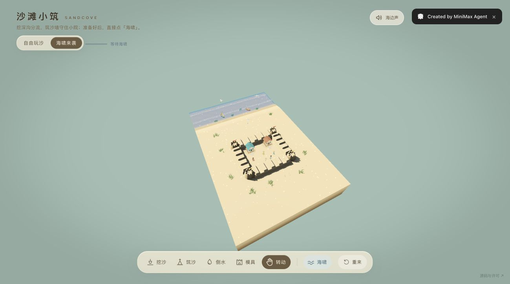

# 沙滩小筑 · SANDCOVE

**用 AI 把一块沙地，做成能筑城、引水、迎接海啸的海滩小游戏。**

[在线试玩 ↗](https://mqr0sn1ljjxnu.space.mcode.cn/) · [本地运行](#本地运行) · [来源与许可](#来源与许可)



挖一条沟，水会顺着地形流过去；堆起沙墙，让它挡住海浪；再发动海啸，看自己搭的沙堡能留下多少。这里没有分数，你可以慢慢造，也可以随时重来。

这是一次以 AI 制作游戏为目标的持续打磨：基于开源 **Sandboard**，由 **MiniMax M3.1 Flash** 完成新增沙地工具、水流与玩法主体，再通过 **Codex 多轮修改**完善交互、冲刷、镜头、海啸、人物与声音。当前版本为 **V19.1**，并非一次提示词生成。

## 在海滩上做什么

- **挖沙、筑沙、倒水**：按住持续塑形，把水池、沟渠和围堤连成自己的水路。
- **搭沙堡**：塔楼、城墙、弧堤直接塑造真实沙地，参与挡水和冲刷。
- **自由玩沙 / 海啸来袭**：安静搭建，或让海浪检验你的防线。
- **转动、缩放和观察**：从不同角度看地形变化，小人会行走、避水，也可能被浪卷走。
- **听海**：首次操作后启用海边环境声和工具反馈，可随时静音。

## 本地运行

推荐 **Node.js 24**。浏览器需要支持 WebGPU 并启用硬件加速；部署需要 HTTPS，本地可用 localhost。

```bash
git clone https://github.com/guzhezao/sandcove.git
cd sandcove
npm ci
npm run dev
```

打开终端输出的本地地址。生产构建和预览：

```bash
npm run build
npm run preview
```

## 操作

| 操作 | 方法 |
| --- | --- |
| 挖沙 / 筑沙 / 倒水 | 底部切换工具，按住或拖动；再次点击工具可调参数 |
| 模具 | 选择形状后放置；`Q` / `E` 转向 |
| 观察 | 选择手形后拖动旋转，滚轮缩放，`Shift` + 拖动平移 |
| 海啸 / 重来 | 底部对应按钮；`R` 重置当前场景 |
| 快捷工具 | `1`–`5` 切换工具，`[` / `]` 调整尺寸 |

## 实现与验证

TypeScript + Vite + WebGPU / WGSL。沙地使用 GPU 高度场，水流使用 256 × 256 浅水网格；水位差驱动流动，水流与沙地冲刷相互影响。

```bash
npm run typecheck
npm test
npm run test:gpu
npm run build
```

GPU 测试需要可用的 WebGPU / Dawn 适配器，普通无 GPU 的 CI 环境可能无法运行。`src/` 为实现，`tests/` 为回归测试，`docs/` 保留技术说明。技术说明部分沿自上游，当前行为以源码和测试为准。

2026-10-28 发布准备验证：91 项普通测试、54 项 GPU 测试、类型检查与生产构建通过；更新开发依赖补丁后，`npm audit` 报告 0 个已知漏洞。

这是轻量高度场和浅水模拟，不支持悬空、洞穴或完整三维卷浪；目前没有存档与关卡系统。设备性能会影响流畅度，没有 WebGPU 时会显示提示。

## 来源与许可

沙滩小筑派生自 **[scottstts / Sandboard](https://github.com/scottstts/Sandboard)**，原作体验：[sand.scottsun.io](https://sand.scottsun.io/)。上游提供了沙地模拟、渲染与基础场景资产，保留原有版权与 **GPL-3.0-only** 许可。

玩法受到 [Steam《沙堡 Sandcastle》](https://store.steampowered.com/app/3216520/Sandcastle/) 启发；本项目不是该游戏的官方版本，也不包含该游戏代码或素材。

当前游戏版本完成于 **2026-10-22**；本仓库于 **2026-10-28** 整理展示文档与源码入口，未改动游戏逻辑。完整许可见 [LICENSE](LICENSE)，来源、资产与修改说明见 [NOTICE.md](NOTICE.md)。

---

**SANDCOVE** is a WebGPU beach sandbox for sculpting sandcastles, digging channels, and watching water reshape the terrain. Built on Sandboard and developed through iterative AI-assisted work with MiniMax M3.1 Flash and Codex. Requires a WebGPU-capable browser; licensed under GPL-3.0-only.
